  
 
 <i>I build at the meeting point of software, design and AI: interfaces that don't just work, but feel good to use.  Maps, 3D, motion, intelligent systems. Wherever engineering turns into an experience.</i> 
  
🏯 The stack, built like a dzong

  
  
🪔 Butter lamps

In a lhakhang, butter lamps are kept burning. These are the ideas I keep lit when I build:

🔆 Simple is a feature you have to build. It never shows up by accident.

🔆 Motion should explain, not decorate. If an animation doesn't tell you what changed, cut it.

🔆 AI belongs inside the interface, not bolted on as one more chat window.

🔆 A map is an interface too. Terrain, routes and place are information people can feel.

🔆 Fast is part of beautiful. A gorgeous page that loads slowly is just a slow page.

 
☸️ Still turning the wheel
ai engineering ........ putting models to work where they actually help
agentic systems ....... agents that use tools without bypassing the rules
generative ui ......... interfaces assembled from intent, not hard-coded screens
3d / webgl ............ three.js and r3f, from experiments to real products
spatial interfaces .... maplibre, terrain and routes across the Himalaya

 
<b>🏔️ What I build</b>
  

Digital products: modern web platforms with real architecture, performance and usability 
AI experiences: AI as part of the interface itself: agents, LLMs, RAG, generative UI 
Spatial computing: maps, terrain, routes, location and spatial information 
Creative technology: motion, 3D, generative visuals and unconventional interfaces

 <!-- 
 
<b>🏹 Off the screen</b>
   Write 2–3 lines about yourself away from the keyboard (archery, hiking, photography...). This is what makes a profile feel like a person. Uncomment when ready. 
 -->  
🐍 Contribution trail
<picture> <source media="(prefers-color-scheme: dark)" srcset="https://raw.githubusercontent.com/Nola77/Nola77/output/snake-saffron-dark.svg"> <source media="(prefers-color-scheme: light)" srcset="https://raw.githubusercontent.com/Nola77/Nola77/output/snake-saffron-light.svg">  </picture>

  

 <b>Make it simple. Make it beautiful. Make it matter.</b> 
 
 <a href="https://github.com/Nola77">github.com/Nola77</a> 
 
<i>Built in Bhutan, connected to the world. Tashi delek.</i>

