<p align="center">
  
</p>

<p align="center">
  <b>ཀུ་ཟུ་ཟང་པོ། &nbsp;·&nbsp; Kuzuzangpo la</b>
</p>

<p align="center">
  
</p>

<p align="center">
  🟦 ⬜ 🟥 🟩 🟨
</p>

<p align="center">
  <i>I build at the meeting point of software, design and AI: interfaces that don't just work, but feel good to use.<br>
  Maps, 3D, motion, intelligent systems. Wherever engineering turns into an experience.</i>
</p>

---

## 🐉 Who I am

I'm **Dorji Phuntsho**, known online as **Nola**: a frontend developer and creative technologist from the Land of the Thunder Dragon (*Druk Yul*).

My name carries two old Bhutanese words: **Dorji** (the thunderbolt, *vajra*) and **Phuntsho** (abundance). I try to build like both: sharp and fast, with plenty of care.

<p align="center">
  <b>CODE</b> &nbsp;×&nbsp; <b>DESIGN</b> &nbsp;×&nbsp; <b>AI</b> &nbsp;×&nbsp; <b>EXPERIENCE</b>
</p>

---

## 🏯 The stack, built like a dzong

<p align="center">
  
</p>

<p align="center">
  
</p>

---

## 🪔 Butter lamps

In a lhakhang, butter lamps are kept burning. These are the ideas I keep lit when I build:

🔆 **Simple is a feature you have to build.** It never shows up by accident.

🔆 **Motion should explain, not decorate.** If an animation doesn't tell you what changed, cut it.

🔆 **AI belongs inside the interface**, not bolted on as one more chat window.

🔆 **A map is an interface too.** Terrain, routes and place are information people can feel.

🔆 **Fast is part of beautiful.** A gorgeous page that loads slowly is just a slow page.

---

## ☸️ Still turning the wheel

```text
ai engineering ........ putting models to work where they actually help
agentic systems ....... agents that use tools without bypassing the rules
generative ui ......... interfaces assembled from intent, not hard-coded screens
3d / webgl ............ three.js and r3f, from experiments to real products
spatial interfaces .... maplibre, terrain and routes across the Himalaya
```

<details>
<summary><b>🏔️ What I build</b></summary>
<br>

- **Digital products**: modern web platforms with real architecture, performance and usability
- **AI experiences**: AI as part of the interface itself: agents, LLMs, RAG, generative UI
- **Spatial computing**: maps, terrain, routes, location and spatial information
- **Creative technology**: motion, 3D, generative visuals and unconventional interfaces

</details>

<!--
<details>
<summary><b>🏹 Off the screen</b></summary>
<br>
Write 2–3 lines about yourself away from the keyboard (archery, hiking, photography...).
This is what makes a profile feel like a person. Uncomment when ready.
</details>
-->

---

## 🐍 Contribution trail

<picture>
  <source media="(prefers-color-scheme: dark)" srcset="https://raw.githubusercontent.com/Nola77/Nola77/output/snake-saffron-dark.svg">
  <source media="(prefers-color-scheme: light)" srcset="https://raw.githubusercontent.com/Nola77/Nola77/output/snake-saffron-light.svg">
  
</picture>

---

<p align="center">
  <b>Make it simple. Make it beautiful. Make it matter.</b>
</p>

<p align="center">
  <i>"Stay curious. Build boldly. Let the work speak."</i>
</p>

<p align="center">
  <code>NOLA / DORJI PHUNTSHO · BHUTAN · 27°N</code><br>
  <code>BUILDING FROM THE HIMALAYAS FOR THE DIGITAL WORLD</code>
</p>

<p align="center">
  <a href="https://github.com/Nola77">github.com/Nola77</a>
</p>

<p align="center">
  <sub><i>Built in Bhutan, connected to the world. Tashi delek. 🇧🇹</i></sub>
</p>
